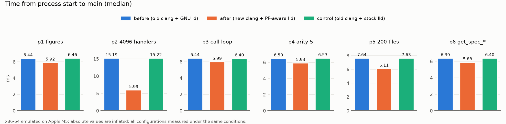
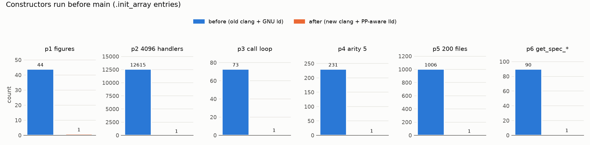
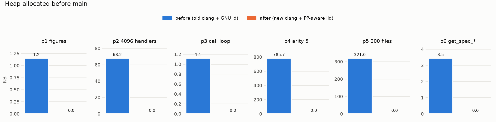
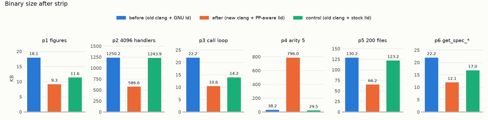
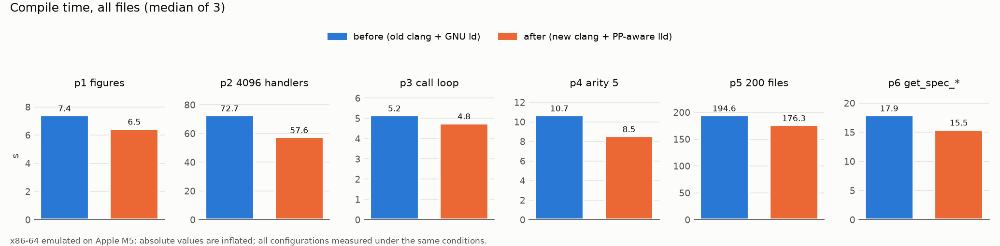
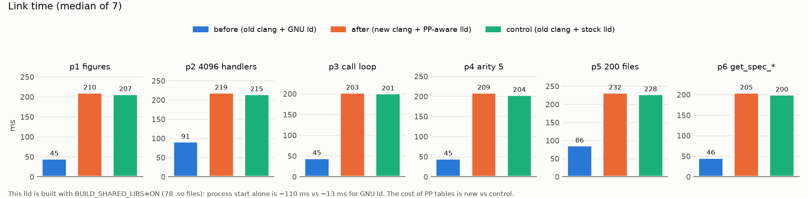
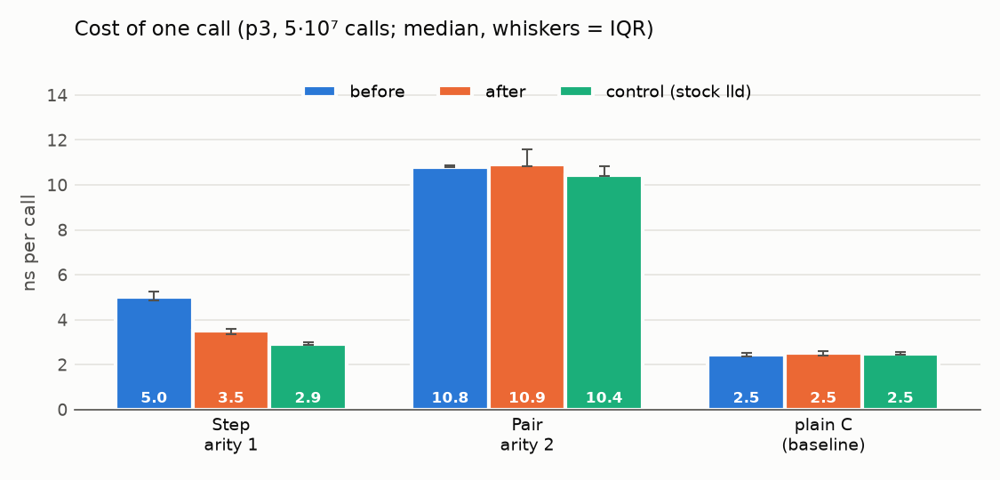
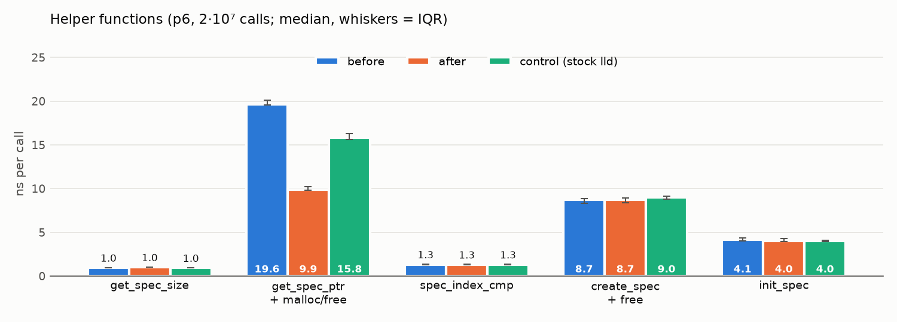

# Before and after: dispatch tables in the linker

This report compares two versions of ppclang:

- **Before** (`ffc3adadb652`): dispatch tables are built by constructors at every program start.
- **After** (`d85a539af699`): dispatch tables are built by LLD at link time.

## Setup

Three configurations, all built with `-O2 -no-pie`:

| | compiler | linker |
|---|---|---|
| **before** | old clang | GNU ld 2.42 (how ppclang was used) |
| **after** | new clang | LLD with PP tables |
| **control** | old clang | stock LLD |

The control configuration separates the effect of the change itself from the
effect of switching from GNU ld to LLD.

There are six test programs:

| | what it stresses |
|---|---|
| p1 figures | a small, realistic program (7 files) |
| p2 4096 handlers | a dense 2-argument multimethod over 65 specializations (66 files) |
| p3 call loop | call cost in a hot loop |
| p4 arity 5 | a sparse 5-argument multimethod, a table of 100 000 cells |
| p5 200 files | many translation units |
| p6 get_spec_* | the runtime helpers `get_spec_size`, `get_spec_ptr`, `create_spec`, `init_spec` |

Times are medians. Startup was run 300 times after 20 warm-up runs, with the
configurations interleaved. Compilation was measured over 3 full builds, linking
over 7 runs.

**Caveat.** Everything ran under x86-64 emulation on an Apple M5 (Docker,
linux/amd64), so absolute times are inflated. The conclusions rely on
comparisons made under identical conditions.

## Startup



After the change, the time to `main` is the same for every program (5.9–6.1 ms),
only the loader runs. Before the change, every registration constructor ran
first, so startup grew with the number of handlers. In p2 it took 15.2 ms instead
of 6.0 ms.



There were more constructors than handlers: in p2 there were 4160 handlers but
12 615 `.init_array` entries. The reason is that every translation unit that
includes a specialization header adds its own initialization entries. After the
change, the only remaining entry is `frame_dummy` from crt.



After the change, nothing is allocated before `main`. Before it, the heap held:

- **p4, 786 KB:** the 100 000-cell table, filled with the default handler on every start.
- **p5, 321 KB = 200 × 1608 bytes:** each of the 200 translation units allocated its own copy of the
  `create_spec` array, and 199 of them leaked.

## Binary size



Binaries shrink by 45–53% after `strip`, and `.text` shrinks by 46–70%. The
per-handler registration functions are gone, and so are their `.eh_frame` and
`.init_array` entries. Some of this comes from switching to LLD, which uses
tighter segment alignment. The effect of the change alone (after vs control) is
−19% to −53%.

**The exception is p4,** which grows from 38 KB to 796 KB. Its 800 000-byte
table used to live on the heap and is now stored in the file. Memory use does
not grow, because the pages are loaded on demand. For ordinary arities the table
is small: 0.2 KB in p1 and 34 KB in p2.

## Compile and link time



Compilation is 8–21% faster, because the compiler no longer generates
registration functions and constructors.



The jump from GNU ld is not caused by this change. This LLD build uses
shared libraries and needs about 110 ms just to start under emulation. The real
cost of building the tables is the difference between *after* and *control*: 2–6 ms,
or 1–3%.

## Call cost



The dispatch code is the same four instructions in both versions:

```
before                                  after
  movslq 0x4(%rdi),%rax   ; tag           mov  0x4(%rdi),%eax              ; tag
  mov  __pp_mminitarr…,%rcx               mov  __start_pp_table_Step,%rcx
  mov  (%rcx,%rax,8),%rax                 mov  (%rcx,%rax,8),%rax
  jmp  *%rax                              jmp  *%rax
```



The runtime helpers now read the `pp_specs_` section directly instead of a heap
array filled by constructors. They behave identically: `get_spec_ptr(Gen, i)`
returns an object whose tag is `i`, in both versions. Their speed is unchanged.
The exception is `get_spec_ptr`, which saves one dependent load; most of its
apparent 50% gain is the same code-placement effect seen above.

## Possible improvements

1. Drop `pp_impl_*` and `pp_desc_*` from the output once the tables are built (−17% size in p2).
2. Expose the number of specializations as an absolute symbol, so a 2-argument call does not
   compute it on every call.
3. Use a compact representation for large sparse tables such as p4.
